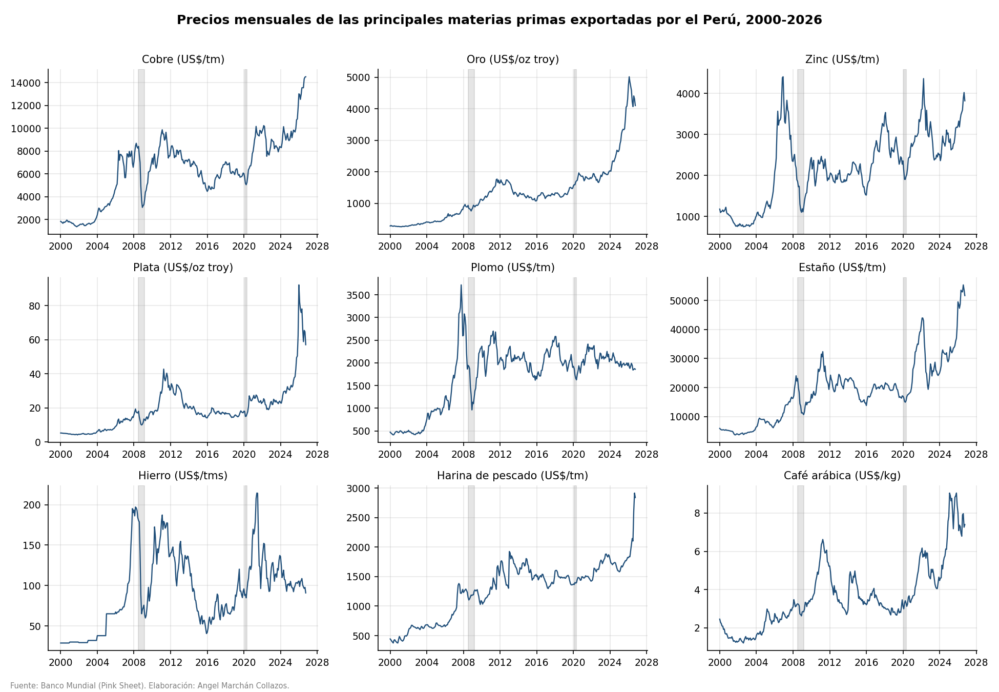
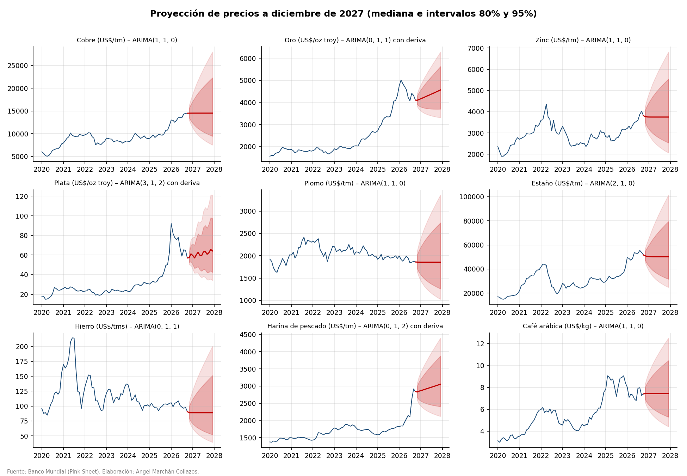
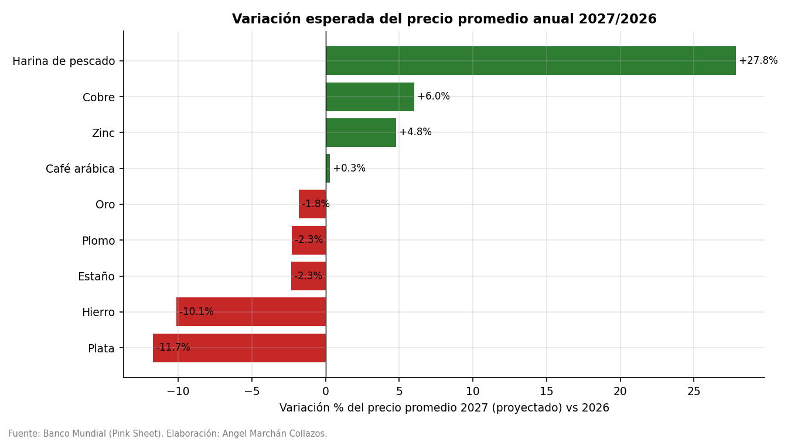

# Modelo  SARIMA para estimar la evolucion de los precios de las principales materias primas que exporta el Perú (2000-2026) 

**Autor:** Angel Marchán Collazos – Universidad Nacional Mayor de San Marcos (UNMSM)
**Fecha:** 25 de octubre de 2026

Modelo econométrico de series de tiempo (metodología Box-Jenkins) para los precios **mensuales** de 9 materias primas de
exportación peruana: cobre, oro, zinc, plata, plomo, estaño, mineral de hierro, harina de pescado y café arábica.
Muestra: enero 2000 – octubre 2026 (322 meses). Proyección: noviembre 2026 – diciembre 2027.

> Los valores de nov-dic 2026 y de todo 2027 son **pronósticos** del modelo, no datos observados.

**Informe completo con interpretación:** [`docs/Informe_ARIMA_SARIMA_materias_primas_Peru.docx`](docs/Informe_ARIMA_SARIMA_materias_primas_Peru.docx)
**Todas las tablas en Excel:** [`output/tablas/resultados_arima_sarima.xlsx`](output/tablas/resultados_arima_sarima.xlsx)

## Datos
- Fuente: Banco Mundial, *Commodity Price Data (Pink Sheet)*, precios nominales mensuales en US$ (actualización del 3-nov-2026).
  Archivo original en `data/raw/`, serie procesada en `data/processed/precios_mensuales_2000_2026.csv`.
- El molibdeno no se incluye porque no está disponible en la fuente.



| Producto | Unidad | Precio ene-2000 | Precio último | Máximo | Fecha máximo | Crec. anual compuesto (%) | Volatilidad anualizada (%) |
|---|---|---|---|---|---|---|---|
| Cobre | US$/tm | 1,844 | 14,508 | 14,508 | 2026-10 | 8.0 | 21.1 |
| Oro | US$/oz troy | 284.0 | 4,105 | 5,020 | 2026-02 | 10.5 | 12.9 |
| Zinc | US$/tm | 1,179 | 3,818 | 4,405 | 2006-12 | 4.5 | 22.2 |
| Plata | US$/oz troy | 5.2 | 57.0 | 92.1 | 2026-01 | 9.4 | 24.9 |
| Plomo | US$/tm | 472.0 | 1,860 | 3,720 | 2007-10 | 5.3 | 22.8 |
| Estaño | US$/tm | 5,928 | 51,696 | 55,385 | 2026-08 | 8.4 | 22.2 |
| Hierro | US$/tms | 28.8 | 90.8 | 214.4 | 2021-06 | 4.4 | 31.6 |
| Harina de pescado | US$/tm | 444.0 | 2,840 | 2,916 | 2026-09 | 7.2 | 16.1 |
| Café arábica | US$/kg | 2.5 | 7.4 | 9.1 | 2025-02 | 4.2 | 20.9 |

## Metodología
1. Variable modelada: `ln(precio)`.
2. **Identificación:** ADF y KPSS (niveles y diferencias), pruebas estacionales OCSB y Canova-Hansen, fuerza estacional STL, FAS/FAP.
3. **Estimación:** máxima verosimilitud (`statsmodels.SARIMAX`); órdenes buscados con Hyndman-Khandakar (`pmdarima.auto_arima`, AIC), por separado para **ARIMA** y **SARIMA(·)(P,D,Q)[12]**, con d = 1.
4. **Selección:** menor BIC entre el mejor ARIMA y el mejor SARIMA.
5. **Diagnóstico:** Ljung-Box, Jarque-Bera, ARCH-LM.
6. **Validación fuera de muestra:** estimación hasta oct-2025 y pronóstico de nov-2025 a oct-2026, comparado con un paseo aleatorio.
7. **Pronóstico** a dic-2027 con intervalos de 80% y 95%.

## Resultados principales
- Todos los log-precios son **I(1)** (ADF no rechaza raíz unitaria en niveles y sí en diferencias; KPSS consistente).
- **No hay estacionalidad significativa** (OCSB y CH: D = 0; fuerza estacional STL ≈ 0): el **BIC elige ARIMA en los 9 productos**; los SARIMA no mejoran ni el ajuste ni el pronóstico (excepto el café fuera de muestra).
- Dinámica cercana a un paseo aleatorio con inercia de corto plazo (AR(1) de 0.18 a 0.40); el **oro** tiene una deriva positiva significativa (≈10.5% anual).
- Los residuos muestran colas pesadas y efectos ARCH (agrupamiento de volatilidad) en varios metales → extensión natural: ARIMA-GARCH.

### Modelos finales (ARIMA)
| Producto | Especificación | AIC | BIC | MAPE validación 12m (%) | MAPE paseo aleatorio (%) |
|---|---|---|---|---|---|
| Cobre | ARIMA(1, 1, 0) | -935.30 | -927.76 | 14.40 | 17.86 |
| Oro | ARIMA(0, 1, 1) con deriva | -1,208 | -1,197 | 7.20 | 8.49 |
| Zinc | ARIMA(1, 1, 0) | -870.98 | -863.43 | 7.44 | 8.85 |
| Plata | ARIMA(3, 1, 2) con deriva | -806.17 | -779.77 | 22.57 | 26.68 |
| Plomo | ARIMA(1, 1, 0) | -846.64 | -839.10 | 3.42 | 3.32 |
| Estaño | ARIMA(2, 1, 0) | -890.35 | -879.03 | 23.85 | 26.15 |
| Hierro | ARIMA(0, 1, 1) | -649.48 | -641.94 | 4.30 | 4.35 |
| Harina de pescado | ARIMA(0, 1, 2) con deriva | -1,075 | -1,059 | 12.84 | 15.00 |
| Café arábica | ARIMA(1, 1, 0) | -897.83 | -890.29 | 17.95 | 17.76 |

### Modelos SARIMA estimados (comparación)
| Producto | Especificación | AIC | BIC | MAPE validación 12m (%) |
|---|---|---|---|---|
| Cobre | SARIMA(1, 1, 0)x(1, 0, 1)[12] | -934.34 | -919.25 | 13.82 |
| Oro | SARIMA(0, 1, 1)x(1, 0, 1)[12] con deriva | -1,204 | -1,185 | 7.25 |
| Zinc | SARIMA(1, 1, 0)x(2, 0, 0)[12] | -876.23 | -861.14 | 8.29 |
| Plata | SARIMA(3, 1, 2)x(1, 0, 1)[12] con deriva | -804.17 | -770.23 | 23.23 |
| Plomo | SARIMA(1, 1, 0)x(1, 0, 1)[12] | -842.66 | -827.58 | 3.40 |
| Estaño | SARIMA(2, 1, 0)x(1, 0, 1)[12] | -886.84 | -867.98 | 24.18 |
| Hierro | SARIMA(0, 1, 1)x(1, 0, 1)[12] | -645.51 | -630.43 | 4.31 |
| Harina de pescado | SARIMA(0, 1, 2)x(1, 0, 1)[12] con deriva | -1,071 | -1,049 | 12.67 |
| Café arábica | SARIMA(1, 1, 0)x(0, 0, 1)[12] | -901.19 | -889.88 | 14.67 |

### Proyección 2027 (US$)
| Producto | Unidad | 2025 (obs.) | 2026 (ene-oct obs. + nov-dic proy.) | Último dato (oct-2026) | 2027 proyectado (mediana) | Var. % 2027/2026 | Dic-2027 LI 95% | Dic-2027 LS 95% |
|---|---|---|---|---|---|---|---|---|
| Cobre | US$/tm | 9,947 | 13,703 | 14,508 | 14,530 | 6.0 | 7,544 | 27,989 |
| Oro | US$/oz troy | 3,442 | 4,442 | 4,105 | 4,362 | -1.8 | 3,312 | 6,290 |
| Zinc | US$/tm | 2,868 | 3,578 | 3,818 | 3,750 | 4.8 | 2,062 | 6,820 |
| Plata | US$/oz troy | 39.8 | 69.7 | 57.0 | 61.6 | -11.7 | 34.0 | 121.3 |
| Plomo | US$/tm | 1,962 | 1,900 | 1,860 | 1,856 | -2.3 | 1,025 | 3,363 |
| Estaño | US$/tm | 34,059 | 51,347 | 51,696 | 50,152 | -2.3 | 24,767 | 101,424 |
| Hierro | US$/tms | 100.2 | 98.7 | 90.8 | 88.7 | -10.1 | 39.2 | 200.7 |
| Harina de pescado | US$/tm | 1,706 | 2,314 | 2,840 | 2,959 | 27.8 | 2,119 | 4,400 |
| Café arábica | US$/kg | 8.5 | 7.4 | 7.4 | 7.4 | 0.3 | 4.4 | 12.5 |




El pronóstico ARIMA de una serie I(1) converge al último nivel observado (más la deriva, si existe).
Por ello, la variación 2027/2026 refleja sobre todo el *efecto arrastre*: cobre, zinc y harina de pescado cerraron 2026 por encima de su
promedio anual (alzas en 2027), mientras plata y hierro cerraron por debajo (caídas). Los intervalos de 95% son amplios
(p. ej., cobre a dic-2027 entre ~US$ 7,500 y ~US$ 28,000/tm), lo que refleja la elevada incertidumbre de estos mercados.


## Cómo ejecutar
```bash
pip install -r requirements.txt
python main.py
```
